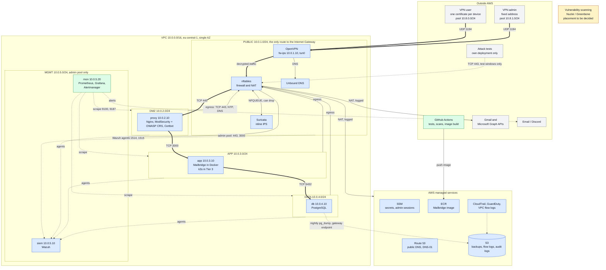

# Secure Mailbridge Lab

Segmented AWS lab running Mailbridge behind OpenVPN, with Suricata inline IPS and Wazuh SIEM.
Design: [docs/ARCHITECTURE.md](docs/ARCHITECTURE.md) · Tasks: [docs/TASKS.md](docs/TASKS.md)

## End-state architecture

This is the planned finished lab, Tiers 1 to 3. It is not what runs today: see [docs/TASKS.md](docs/TASKS.md) for current progress.
[docs/ARCHITECTURE.md](docs/ARCHITECTURE.md) stays the source of truth.

**Colours:** blue is Tier 1, green is Tier 2, amber is Tier 3, grey is outside the lab.
**Lines:** thick is the user request path, thin is admin and outbound traffic, dotted is telemetry, backups and test-only paths.

- **One way in:** clients reach the app only through OpenVPN. TCP 443 on fw-ips opens only for outside-attack test windows.
- **One hop at a time:** proxy talks to app, and app talks to db. No subnet can skip a layer.
- **Inspected and attributable:** Suricata sees decrypted VPN traffic inline. VPN pools are routed, not NATed, so every log shows the real client address.
- **Private by default:** `mail.<domain>` resolves only inside the VPN, and all private subnets leave through fw-ips.

TODO: one-command deploy + teardown (`make up` / `make down`) once the Makefile exists.
